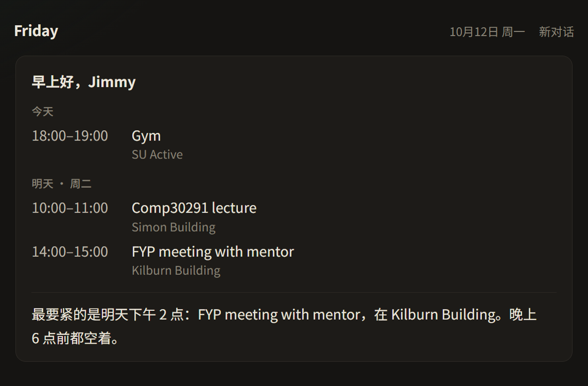

# Friday

> **交给 Friday，然后就可以忘了。**

演示日历里的周一早上 9 点。卡片和那句话都由服务端从日历直接算出，不经过模型。

## 一个周二

（示例，数据是编的）

**人在哪都能找到他。** 中午在图书馆，点开 iPhone 上的 Friday：「今晚有空吗？」同一段关系，同一份日历和待办——脑子在云上，电脑关机也能聊。

**开口就能聊。** 走路回宿舍，按住说话：「Lab 3 周四交。」它听完记下，回一句你听得见的「记下了」。

**需要时看一眼外面。** 晚上你问：「最近有什么值得看的大新闻？」它给两三条，每条带出处；没有来源就不装懂。

电脑上仍然快：Ctrl+Alt+F，今天已经在那儿；日历、Tasks、Gmail 真的能动。骨架是这些。贾维斯感来自：随时在、能开口、偶尔看得懂世界——不是功能清单勾满。

这段话里的体感，才是要做到的；不在路线里的，先不做。

## 四个「绝不」

只有一个 Friday，和你一段关系。对话就是界面，工具藏在后面。

1. **绝不说假话。** 日程、邮件、记忆、外面的新闻和行情，都只来自真实数据或工具结果；不知道就说不知道。看世界也绝不瞎编。
2. **绝不让你等。** 按下就在，开口就是答案，不给你列选项。
3. **绝不问你已经说过的事。** 说一次，它就记住；说错了，纠正一次就改对。
4. **绝不没经过你就动手。** 读可以直接读；发邮件、改日程、删东西，先问你一次。待办直接记下、划掉，页面给「撤销」。

做到这四条，靠一个原则：**能算的先算好，模型只照着说。** 时间、日子、几项、隔多久，都由服务端算好写进数据；开场那句话干脆整句由服务端写好。外面的世界同样：先查到，再说。

好看、利落、细节到位，是每一次提交的标准，不是一个阶段。

## 两个数字

- **每个工作日，你都主动打开它**（电脑或手机）。
- **它说错的次数：0。**

其余的数字都是工程目标，见下面的质量线。

## 已经有的骨架（保住）

- **快**：快捷键到窗口、开场卡片和那句话一起到。
- **真能动手**：Google 日历、Google Tasks、Gmail。
- **一个代理**：电脑和手机是同一段关系，不另做人。
- **云上大脑**：Fly.io（`friday-jimmy`）常开；电脑可关机。
- **脸**：黑白、白环；桌面快捷方式用 `friday-ring.ico`。

待办第一刀已进 develop：一句话记下、到期回来、划掉、撤销。

## 路线：五刀（前面没好就不碰后面）

按体验伤口往前砍。每刀做完先真用；周二不会自己打开，就先修原因，不往下走。

### 刀 0 · 一按就在 · 做完了

电脑上 Ctrl+Alt+F：安排排好，那句话一起到。10 月 16 日全量实测通过。

### 刀 1 · 杀掉「这是个网站」 · 正在做

**做到：** 主屏幕一个图标，点开就是 Friday。登录一次就记住你；没有地址栏里的 `?access=`、没有「再贴一遍访问码」。

按依赖拆（做完一截真用一截）：

1. **云上** — 已通：Fly + Docker；`scripts\deploy_fly.py`。  
2. **会话登录** — 密码换 httpOnly Cookie；电脑 / 手机 / 以后 App 共用。访问码链接只作一次性兑换。  
3. **iPhone 壳** — Capacitor 包现有界面，装到你手机（Xcode / TestFlight）；不急着公开上架。

整条链路：[cloud-and-iphone.md](cloud-and-iphone.md)。隧道只作开发过渡。

**演示时刻：** 主屏幕点 Friday →（至多输一次密码）→「提醒我下午续借书」→ Tasks 里有；电脑关机也行。

### 刀 2 · 同一张脸，两处入口 · 跟在刀 1 后面验

**做到：** 手机 App 和电脑快捷方式打同一套云 API。关掉 PC，手机照样在；坐回桌前，还是同一个人。两边若像两个产品，整条线重做。

### 刀 3 · 用一周真生活验收 · 门禁

只问：日程对不对、待办能不能加、会不会编造。周二中午你会不会自己打开——不会，就冻结花活。

### 刀 4 · 开口就聊 · 壳稳了之后

**做到：** 能说、能听——先电脑，再和手机汇合。不是永远在听的全双工电影贾维斯。

**演示时刻：** 走路时口述一件待办，它听懂并记下。

### 刀 5 · 看得懂外面 · 再往后

**做到：** 新闻、行情——有出处；没有结果就说没有。不做无人值守炒股或自动发帖。

**演示时刻：** 「最近有什么大新闻？」→ 两三条带链接。

### 收口 · 更像 Friday · 最后磨

人味、干幽默——改 `VOICE` 和开场语气，不靠堆功能。排在「在场」之后。

### 更后 · 替你做完

说一句，事情办完，你只点一次确认：回邮件、改日程。评测仍冻结到周二爱用过关；合并 `main`、打 tag 之前先问 Jimmy。

## 先不做（别拿它们当进度）

- 开场白塞要紧邮件、周日晚看一整周、会前主动推要点  
- 课的截止日历订阅、学校邮件转发  
- 记忆的单独管理界面  
- 多智能体、「AI 员工」、花哨仪表盘、为炫技的浏览器托管  
- App Store **公开**上架与平台运营后台（先 TestFlight 给你自己；多用户隔离等第二个真人要用再做）  
- 为了幽默牺牲「绝不说假话」

## 质量线

| 体验 | 现在 | 目标 |
| --- | --- | --- |
| 按下到窗口出现 | 0.41–0.47 秒 | ≤ 0.5 秒 |
| 打开到第一个字 | 0.74 秒，卡片和那句话一起到 | ≤ 1.5 秒 |
| 问日程，第一个字 | 0.5–1.4 秒 | ≤ 2 秒 |
| 不用查东西的回答，第一个字 | 0.6–1.4 秒 | ≤ 1 秒 |
| 说错 | 测试中出现过 7 类，都已修复并复测 | 0 |
| 未经确认的写操作 | 0 | 0 |

---

每一项怎么做的、实测记录、提交、风险和决定：[工程记录](engineering-log.md)。怎么装、怎么开：[README](../README.md)。
